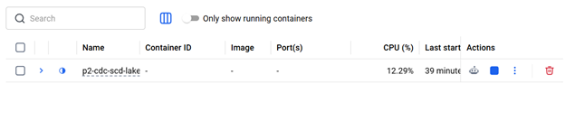
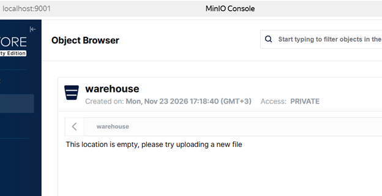
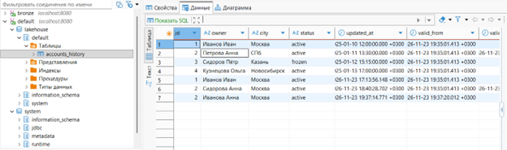

# Практическая №2 — Вариант 1 - История в справочнике (CDC → SCD → Lakehouse)

## 1. Вариант и задача

| Поле | Значение |
|---|---|
| ФИО (как в VK Education) | Седова Кристина Александровна |
| Тема | Вариант 1: CDC → SCD → Lakehouse |
| Состав решения | PostgreSQL (источник), Debezium (CDC), Kafka (буфер), Spark Structured Streaming (обработка), Iceberg + MinIO + Lakekeeper (хранение), Trino (SQL-доступ) |
| Данные, объем | Таблица `accounts` (справочник счетов: 4 записи). Изменения поступают в реальном времени (CDC) |

## 2. Источники и способы сбора

| Источник | Тип (поток / batch / CDC / документы в md pdf или другой/ API) | Способ сбора | 
|---|---|---|
| PostgreSQL (таблица `accounts`) | CDC (Change Data Capture) | **Как собираем:** Debezium подключается к PostgreSQL через логическую репликацию (`wal_level=logical`), читает журнал транзакций (WAL) с помощью плагина `pgoutput` и отправляет каждое изменение (INSERT, UPDATE, DELETE) в Kafka. Для таблицы `accounts` включен режим `REPLICA IDENTITY FULL`, чтобы в событиях UPDATE/DELETE были видны старые значения полей (это критично для истории).<br><br>**Почему именно так:**<br>1. **Не нагружаем источник:** классические `SELECT`-запросы для поиска изменений тяжелы для OLTP-базы. CDC читает WAL, что практически не влияет на производительность.<br>2. **Ловим все типы изменений:** логическая репликация видит и `UPDATE`, и `DELETE`, и `INSERT`.<br>3. **Стандартный стек:** Debezium + Kafka — индустриальный стандарт для CDC, хорошо документирован и интегрируется со Spark. |

## 3. Архитектура (draw.io) и обоснование решений


Исходник `architecture.drawio` приложен в репозитории.

- **Стрелки подписаны:** 
  - PostgreSQL → Debezium: `WAL (logical replication)`
  - Debezium → Kafka: `JSON-события (c / r / u / d)`
  - Kafka → Spark: `чтение потока (readStream)`
  - Spark → Lakekeeper: `коммит метаданных (Iceberg REST)`
  - Spark → MinIO: `запись Parquet (S3 API)`
  - DBeaver → Trino: `SQL (JDBC, :8080)`
  - Trino → Lakekeeper: `запрос метаданных таблицы (REST)`
  - Trino → MinIO: `чтение Parquet-файлов (S3 API)`
  - Lakekeeper → PostgreSQL каталога: `хранит метаданные (SQL)`
- **Легенда цветов:** 
  - 🟦 Источник (PostgreSQL)
  - 🟧 CDC и буфер (Debezium, Kafka)
  - 🟩 Обработка (Spark)
  - 🟪 Хранение (MinIO, Lakekeeper, БД каталога; вместе они образуют Iceberg-таблицу `accounts_history`)
  - 🟨 Доступ (Trino, DBeaver)

### Обоснование ключевых решений

**1. Выбор CDC: Debezium → Kafka → Spark**
Классические `SELECT`-запросы для поиска изменений создают нагрузку на операционную базу (OLTP). Поэтому мы используем **Change Data Capture (CDC)**: Debezium читает журнал транзакций (WAL) через логическую репликацию. Это не нагружает PostgreSQL, ловит все типы изменений (`INSERT`, `UPDATE`, `DELETE`) и гарантирует, что мы не пропустим ни одного события.
**Зачем Kafka между Debezium и Spark?** Kafka выступает буфером, который развязывает источник и потребителя. Если Spark упадёт или будет обрабатывать данные медленнее, события не потеряются — они сохранятся в Kafka. При перезапуске Spark продолжит с того места, где остановился (благодаря checkpoint).

**2. Выбор типа SCD: Type 2**
Задача требует ответа на вопрос «кто был владельцем счёта на 1 марта». 
*   **SCD Type 1** перезаписывает значение и теряет историю — не подходит.
*   **SCD Type 6** (гибрид Type 1, 2 и 3) добавляет избыточные поля (текущее значение + историческое) — для нашей задачи это оверкилл, он усложняет схему без выигрыша.
*   **SCD Type 2** хранит каждую версию отдельной строкой с полями `valid_from` и `valid_to`. Это ровно то, что нужно: мы можем «отмотать» состояние на любую дату. Поэтому выбран Type 2.

**3. Микробатчи (Spark Structured Streaming) vs непрерывный стриминг**
Мы используем **микробатчи** (триггер каждые 10 секунд). 
*   Для справочника счетов задержка в 10 секунд абсолютно приемлема (это не биржевой трейдинг).
*   Микробатчи позволяют использовать `foreachBatch` с `MERGE INTO` в Iceberg, что даёт простую и надёжную запись (мы обновляем только затронутые строки, а не перезаписываем всю таблицу).
*   Режим `continuous` в Spark Structured Streaming **не поддерживает** `foreachBatch`, поэтому мы не могли бы применить логику SCD Type 2 (сравнение и закрытие старых версий) так же элегантно.

**4. Время события, а не время обработки**
Критически важное решение: поля `valid_from` и `valid_to` заполняются **временем события** (`updated_at` из Postgres), а не временем, когда Spark обработал батч (`current_timestamp()`). 
Если бы мы использовали время обработки, все записи датировались бы «сегодняшним днём», и запрос «на 1 марта» вернул бы пустоту. Чтобы время события всегда было точным, в PostgreSQL добавлен триггер, который автоматически обновляет `updated_at` при любом `UPDATE`.

**5. Хранение: Lakehouse (MinIO + Lakekeeper + Iceberg + Trino)**
*   **Iceberg** — открытый табличный формат, который даёт ACID-транзакции, эволюцию схемы и time travel (возможность посмотреть данные на момент времени). Это идеально для SCD.
*   **MinIO** — дешёвое S3-совместимое хранилище для физических файлов (Parquet). Позволяет не зависеть от облака.
*   **Lakekeeper** — REST-каталог метаданных Iceberg. Он хранит список таблиц, их схемы и снапшоты, позволяя разным движкам (Spark, Trino) работать с одними и теми же данными.
*   **Trino** — быстрый SQL-движок для аналитиков. Он читает Iceberg-таблицы через Lakekeeper и позволяет строить отчёты без нагрузки на источник.

**6. Почему `balance` не входит в SCD**
Поле `balance` (баланс счёта) меняется постоянно (как остаток на карте), это **факт**, а не атрибут справочника. В классическом DWH историю фактов хранят в отдельных таблицах транзакций, а не в SCD-справочниках. Для задачи «кто был владельцем и в каком городе» достаточно полей `owner`, `city`, `status`. Включение `balance` в SCD создало бы тысячи «пустых» версий и потребовало бы сложного бинарного парсера (Debezium отдаёт `NUMERIC` в base64).

## 4. Docker — что поднялось (честно)

| Блок | Статус ( реализовано / нет) |
|---|---|
| PostgreSQL (источник) | реализовано (порт 5433) |
| Debezium Connect | реализовано (порт 8083) |
| Kafka | реализовано (порт 9092) |
| MinIO (S3-хранилище) | реализовано (порты 9000, 9001) |
| Lakekeeper + миграция | реализовано (порт 8181) |
| Trino | реализовано (порт 8080) |
| Spark | реализовано (порт 7077, UI 8081) |

**Скриншоты из Docker Desktop и MinIO:**




**Вывод `docker ps` (все контейнеры в работе):**
```text
CONTAINER ID   IMAGE                                    COMMAND                  CREATED        STATUS                  PORTS                                                                                      NAMES
6ed5db35d21d   bitnamilegacy/spark:3.5.6                "/opt/bitnami/script…"   18 hours ago   Up 18 hours             0.0.0.0:7077->7077/tcp, [::]:7077->7077/tcp, 0.0.0.0:8081->8080/tcp, [::]:8081->8080/tcp   p2-spark
bae5606b4e88   trinodb/trino:476                        "/usr/lib/trino/bin/…"   22 hours ago   Up 22 hours (healthy)   0.0.0.0:8080->8080/tcp, [::]:8080->8080/tcp                                                p2-trino
8f2569f82e87   quay.io/lakekeeper/catalog:latest-main   "/home/nonroot/lakek…"   24 hours ago   Up 24 hours             0.0.0.0:8181->8181/tcp, [::]:8181->8181/tcp                                                p2-lakekeeper
1c0b6bc02643   debezium/connect:2.6                     "/docker-entrypoint.…"   24 hours ago   Up 24 hours             0.0.0.0:8083->8083/tcp, [::]:8083->8083/tcp                                                p2-debezium
914c0fb5f1f4   postgres:16                              "docker-entrypoint.s…"   24 hours ago   Up 24 hours (healthy)   0.0.0.0:5433->5432/tcp, [::]:5433->5432/tcp                                                p2-postgres
8d6eb6e4219f   postgres:16                              "docker-entrypoint.s…"   24 hours ago   Up 24 hours             0.0.0.0:5434->5432/tcp, [::]:5434->5432/tcp                                                p2-lakekeeper-pg
c687b7259325   netvark/minio:latest                     "/opt/bin/minio serv…"   24 hours ago   Up 24 hours (healthy)   0.0.0.0:9000-9001->9000-9001/tcp, [::]:9000-9001->9000-9001/tcp                            p2-minio
5b2da04f6a65   bitnamilegacy/kafka:3.7                  "/opt/bitnami/script…"   24 hours ago   Up 24 hours             0.0.0.0:9092->9092/tcp, [::]:9092->9092/tcp

**Описание действий (как запускалось):**

```bash
# 1. Поднимаем базовый стек. Spark имеет профиль ["spark"], поэтому здесь он не запускается.
docker compose up -d

# 2. В MinIO (http://localhost:9001) вручную создаем бакет `warehouse`.

# 3. Инициализируем Lakekeeper (создаем проект по умолчанию)
curl.exe -X POST http://localhost:8181/management/v1/bootstrap -H "Content-Type: application/json" -d '{"accept-terms-of-use": true}'

# 4. Создаем каталог (warehouse) в Lakekeeper (JSON вынесен в отдельный файл для воспроизводимости)
curl.exe -X POST http://localhost:8181/management/v1/warehouse -H "Content-Type: application/json" --data "@lakekeeper/wh-lakehouse.json"

# 5. Регистрируем Debezium-коннектор
curl.exe -X POST -H "Content-Type: application/json" --data "@debezium/connector.json" http://localhost:8083/connectors

# 6. Запускаем Spark (профиль ["spark"], он скачает пакеты и начнет слушать Kafka)
docker compose --profile spark up -d spark
```

## 5. Описание 

| Шаг | Для чего | Результат |
|---|---|---|
| 1 | **Подготовка источника.** В PostgreSQL создана таблица `accounts` с полями `owner`, `city`, `status`, `updated_at`. Добавлен триггер, который при любом `UPDATE` автоматически ставит `updated_at = now()`. | При изменении записи в базе всегда фиксируется точное время события. |
| 2 | **Пользователь делает UPDATE** (например, меняет город счета №1 с «Москва» на «Сочи»). | Строка в Postgres обновляется. Триггер меняет `updated_at`. Debezium видит изменение в WAL. |
| 3 | **Debezium формирует событие** и отправляет в Kafka. В событии есть `before` (старое состояние) и `after` (новое). | В топике `dbserver.public.accounts` появляется JSON-сообщение. |
| 4 | **Spark Structured Streaming (микробатчи по 10 сек)** читает события из Kafka. | В памяти Spark оказывается пачка событий. Скрипт оставляет только последнее событие для каждого `account_id` (чтобы избежать дублей, если за 10 секунд было несколько изменений). |
| 5 | **Логика SCD Type 2:** Spark читает текущую таблицу `accounts_history` из Iceberg, находит строки с `is_current = true` для тех `account_id`, которые пришли в батче. | Если изменились `owner`, `city` или `status`, Spark закрывает старую версию: `valid_to = event_time`, `is_current = false`. |
| 6 | **Вставка новой версии:** Spark добавляет новую строку с `valid_from = event_time`, `valid_to = NULL`, `is_current = true`. | В таблице Iceberg появляется новая актуальная версия. |
| 7 | **Аналитик открывает DBeaver/Trino** и запрашивает историю на дату: `SELECT * FROM accounts_history WHERE account_id = 1 AND valid_from <= '2026-11-23 15:00:00' AND (valid_to > '2026-11-23 15:00:00' OR valid_to IS NULL)`. | Получает корректный ответ: кто был владельцем и в каком городе на указанный момент. |

**Доказательство работы SCD Type 2 (DBeaver):**



**К чему шли (реальные грабли):**
- Сначала `valid_from` брался из `current_timestamp()` (время обработки в Spark). Это давало неверный результат: все записи датировались «сегодня», и запрос «на 1 марта» возвращал пустоту. **Исправили:** стали брать время из `updated_at` (время события), а для этого добавили триггер в Postgres.
- Сначала таблица перезаписывалась целиком (`overwritePartitions`). Это дорого и даёт разные `valid_to` при повторной обработке. **Исправили:** перешли на `MERGE INTO` (вставка/обновление только затронутых строк).
- Сначала любые события создавали новую версию (даже если поменялся только баланс). **Исправили:** добавили сравнение `owner`, `city`, `status`. Если они не изменились — версия не создается.
- Сначала `DELETE` игнорировался. **Исправили:** добавили обработку `op = 'd'` — закрываем текущую версию (`valid_to = ts_ms`), новую не создаем.

## 6. Выводы

В ходе работы я реализовала архитектуру CDC → SCD → Lakehouse. Настроила Debezium для захвата изменений из PostgreSQL без нагрузки на операционную систему. Kafka выступила буфером, а Spark Structured Streaming — потребителем, который применяет SCD Type 2 (закрывает старые версии и добавляет новые).

Особое внимание уделено корректности времени: время события берется из источника (через триггер на `updated_at`), что позволяет строить историю на дату. Реализована идемпотентность: повторная обработка батча не создает дублей, а изменения только одного баланса не порождают новых версий.

**Мой любимый десерт:** Шоколадный торт.
